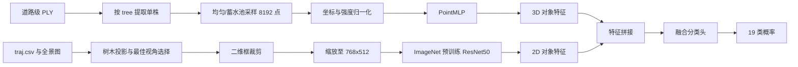

# TSCMDL 在 WHU-STree 上的复现方案

更新时间：2026-07-14

## 1. 复现目标

本方案复现的是 WHU-STree 论文中的 TSCMDL 分类基线，而不是照搬 TSCMDL 原论文的 UAV LiDAR 与正射影像实验。

WHU-STree 版本的目标任务为：

- 输入：单株树木点云和与其对应的街景全景影像裁剪。
- 输出：18 个主要树种加 `Others`，共 19 类。
- 点云分支：PointMLP。
- 图像分支：ResNet50。
- 融合方式：拼接两个分支的对象级特征，再进行分类。
- 论文对照结果：TSCMDL `mIoU=60.5%`、`OA=86.2%`。
- 单模态对照：PointMLP `mIoU=58.0%`、`OA=84.5%`；ResNet `mIoU=53.7%`、`OA=83.4%`。

复现分为三个等级：

| 等级 | 判定标准 |
|---|---|
| 工程复现 | 数据预处理、训练、验证、测试和结果图可以完整运行 |
| 协议复现 | 数据划分、8192点输入、768×512影像输入、19类口径和论文指标一致 |
| 数值复现 | 三次独立运行的均值接近论文报告结果，并保持融合模型优于两个单模态分支 |

由于 WHU-STree 没有公开其 TSCMDL 适配代码、完整训练配置和全部投影参数，工程复现和协议复现可以完成，数值完全一致不能预先保证。

## 2. 依据与已确认条件

### 2.1 论文处理记录

- PDF 解析环境：`pdf-reading` conda 环境。
- 解析器：PyMuPDF。
- 中间文本：`D:\TREE\paper reading\output\1-s2.0-S0924271626000626-main_extracted.txt`。
- 视觉核对页：`D:\TREE\paper reading\output\1-s2.0-S0924271626000626-main_rendered_pages\page_16.png`。
- 附录确认：单株点云统一采样至 8192 点；影像裁剪缩放至 768×512。

PyMuPDF 对正文和附录段落的解析质量较好，但论文没有给出 WHU 版 TSCMDL 的完整优化器参数、融合头维度和随机种子。投影坐标轴约定、传感器杆臂偏移及接缝处理也需要通过本地数据实验确认。

### 2.2 本地数据状态

数据根目录：`D:\TREE\lidar data\whu`

| 数据 | 当前状态 |
|---|---:|
| 道路区块 | 35 |
| 轨迹 | 110 |
| PLY 点云 | 110 个，约 92.32 GiB |
| 全景影像 | 10,907 张，约 189.74 GiB |
| 测试轨迹 | 26 |
| 总点数 | 约 25.32 亿 |

训练轨迹的 PLY 含 `x, y, z, intensity, tree, label`。测试轨迹的 PLY 只有 `x, y, z, intensity`，对应 `reference_data/*.npy` 与点数完全一致，包含两列 `int16` 真值：实例编号和树种编号。

### 2.3 标签口径

- 原始标签 `0-17` 保留为 18 个主要树种。
- 原始标签大于 17 的稀有树种统一映射为 `Others=18`。
- 无效点、背景点和没有有效树实例编号的点不得生成单树样本。
- 每个实例必须只有一个有效树种标签；出现标签冲突时进入异常清单，不自动多数投票修复。

## 3. 总体架构



模型同时提供三个运行模式：

| 模式 | 输入 | 用途 |
|---|---|---|
| `point_only` | 8192点单树点云 | 对照 PointMLP 基线 |
| `image_only` | 768×512树木裁剪 | 对照 ResNet50 基线 |
| `fusion` | 点云＋对应影像 | TSCMDL 复现 |

只有两个单模态基线都通过验收后，才训练融合模型。

## 4. 隔离目录规划

代码与数据严格分离，原始 WHU-STree 数据保持只读。

```text
D:\TREE\Lidar\tscmdl_whu_sandbox\
├── configs\
│   ├── data_whu19.yaml
│   ├── pointmlp_whu19.yaml
│   ├── resnet50_whu19.yaml
│   └── tscmdl_whu19.yaml
├── scripts\
│   ├── build_tree_samples.py
│   ├── build_image_pairs.py
│   ├── audit_pairs.py
│   ├── train.py
│   └── evaluate.py
├── src\
│   ├── data\
│   ├── geometry\
│   ├── models\
│   ├── metrics\
│   └── utils\
└── tests\

D:\TREE\lidar data\whu\derived\tscmdl\
├── manifests\
├── point_samples\
├── image_crops\
├── pair_audit\
├── splits\
└── runs\
```

代码目录可以纳入 Git；`derived`、模型权重、裁剪图、缓存和日志不得纳入 Git。

## 5. 数据处理方案

### 5.1 单树点云提取

不生成完整的逐树原始点云副本。每个 PLY 只做分块顺序读取，并直接生成固定大小的分类样本。

处理步骤：

1. 读取 PLY 文件头，确定点数、属性和二进制偏移。
2. 以固定块大小读取点数据，避免一次载入数千万点。
3. 训练轨迹从 `tree/label` 读取真值；测试轨迹从同名 `.npy` 同步读取真值。
4. 按 `(road_id, trajectory_id, tree_id)` 建立全局唯一实例编号。
5. 对每棵树进行蓄水池采样，最多保留 8192 点。
6. 少于 8192 点的实例保留全部点，并以有放回采样补足；同时记录原始点数。
7. 保存为独立 `.npz`，包含 `xyz`、`intensity`、`label` 和实例元数据。

坐标预处理默认采用：

- `xyz` 减去单树质心。
- 水平尺度按最大冠幅归一化，垂直方向保留相对高度比例。
- `intensity` 按训练集统计量标准化。
- 训练增强使用绕 Z 轴旋转、轻微尺度扰动、坐标抖动和随机点丢弃。

为忠实比较，首先训练仅使用 `xyz` 的论文式基线，再将强度作为消融实验加入，不能把增强版本直接当作论文复现结果。

### 5.2 全景影像关联

`traj.csv` 每行提供图像文件名、相机位置和 `heading/pitch/roll`。全景图为 8192×4096，需要按等距柱状投影处理。

处理步骤：

1. 根据单树三维包围盒中心，在同一轨迹中检索候选曝光站。
2. 将树木点从世界坐标转换到相机坐标。
3. 将方位角和俯仰角映射到全景像素坐标。
4. 投影单树点或三维包围盒角点，生成二维边界框。
5. 处理跨越全景左右接缝的树木，禁止产生横跨整幅图像的错误框。
6. 为边界框增加 10%-20% 上下文边距。
7. 按可见点比例、投影面积、距离和边缘畸变综合选择最佳单视角。
8. 裁剪后缩放到 768×512，并记录原图、曝光站和投影参数。

首轮保持论文的单视角输入。多视角投票、SAM 背景抑制和人工多边形 mask 只能作为后续增强实验，不能混入论文基线。

### 5.3 投影质量门槛

先随机抽取至少 200 棵树，生成“全景图＋投影点＋裁剪框”叠加图进行人工检查。

| 问题 | 处理方式 |
|---|---|
| 坐标轴方向错误 | 校准 heading/pitch/roll 旋转顺序与正负号 |
| 整体固定偏移 | 估计相机和激光扫描仪之间的杆臂偏移 |
| 接缝处分裂 | 使用环形横坐标和接缝感知包围框 |
| 遮挡严重 | 更换候选曝光站或将样本标记为低质量 |
| 树木过小 | 设置最小投影面积，不满足时排除图像分支 |

有效配对通过率达到 95%，且严重错框低于 2%，才能启动 TSCMDL 融合训练。未达到门槛时可以先完成 PointMLP，但不能用错误影像强行训练融合模型。

## 6. 数据划分

- 论文测试集严格采用 `D:\TREE\lidar data\whu\test_split.txt` 中的 26 条轨迹。
- 剩余轨迹用于训练和验证。
- 验证集按道路或完整轨迹分组抽取，不能逐树随机拆分。
- 同一全景图关联的树不能跨越训练、验证和测试集合。
- 测试集的 `reference_data` 只用于最终评估，不参与模型选择和超参数搜索。
- 划分脚本同时输出每个集合的类别、道路、轨迹和图像数量统计。

论文基线先使用普通交叉熵，不做类别重加权。类别权重、Focal Loss、重采样等长尾策略作为独立增强实验报告。

## 7. 模型实现

### 7.1 PointMLP 分支

以 PointMLP 官方 PyTorch 分类实现为基础：

`https://github.com/ma-xu/pointMLP-pytorch`

需要完成的适配：

- 输入点数从原数据集配置改为 8192。
- 类别数改为 19。
- 数据读取改为 WHU 单树 `.npz`。
- 将最终分类层前的全局特征暴露给融合模型。
- 保留 PointMLP 的几何仿射模块和残差 MLP 主体。

### 7.2 ResNet50 分支

- 使用 ImageNet 预训练 ResNet50。
- 删除原始 1000 类全连接层。
- 输入为 768×512 RGB 树木裁剪。
- 输出全局图像特征给融合模型。
- 先冻结低层卷积进行预热，再解冻高层微调。

### 7.3 融合分类头

忠实模式优先采用两个 backbone 的倒数第二层特征直接拼接，然后接全连接分类头。PointMLP 特征维度、ResNet50 的 2048 维特征以及融合头维度必须写入运行配置和结果报告。

工程默认候选结构为：

```text
PointMLP feature ─┐
                  ├─ Concatenate ─ Linear ─ BatchNorm ─ ReLU ─ Dropout ─ Linear(19)
ResNet50 feature ─┘
```

如果获得 TSCMDL 原论文完整网络表，应新增 `paper_exact` 配置，不覆盖当前 `whu_equivalent` 配置。

## 8. 8GB 显存训练配置

当前 GPU 为 RTX 5060 Laptop 8GB，建议初始配置：

| 参数 | 建议值 |
|---|---|
| 精度 | AMP 混合精度 |
| 物理 batch size | 1-2 |
| 梯度累积 | 累积至有效 batch 8-16 |
| 图像尺寸 | 固定 768×512，显存不足时先冻结 ResNet 低层 |
| 点数 | 固定 8192，不为了显存擅自降低论文输入点数 |
| DataLoader workers | 2-4 |
| 优化器 | AdamW，分支学习率分别配置 |
| 调度器 | warmup＋cosine decay |
| 最长轮次 | 100，验证集早停 patience 15 |
| 随机种子 | 至少 3 个独立种子 |

建议为 ResNet 预训练层使用较低学习率，为 PointMLP 和融合头使用较高学习率。所有数值放在 YAML 配置中，不硬编码到模型文件。

当前 `yolo` 环境使用较新的 PyTorch nightly，TSCMDL 不应直接修改该环境。应建立隔离环境，例如 `whu-tscmdl`，并先确认 PointMLP 的 `pointnet2_ops` 是否能在当前 Windows/CUDA 组合编译。若原扩展无法稳定编译，优先建立 WSL2 Linux 环境；不在主环境中反复降级 PyTorch。

## 9. 训练顺序与阶段门槛

### 阶段 A：数据工程验证

- 只处理一条非测试轨迹。
- 验证 PLY 与标签同步读取。
- 验证每棵树的8192点输出。
- 生成至少20个点云可视化和20个影像投影叠加图。

通过标准：实例数、类别和点数可以追溯；没有坐标错位和标签错位。

### 阶段 B：三类共有树种小试验

使用：

- `Cinnamomum camphora`
- `Lagerstroemia indica`
- `Magnolia grandiflora`

依次训练 `point_only`、`image_only` 和 `fusion`。该阶段用于验证多模态数据流，不作为19类论文结果。

通过标准：三个模型都可完成训练与测试，融合模型没有因错误配对显著低于两个单模态模型。

### 阶段 C：完整19类基线

依次完成：

1. PointMLP。
2. ResNet50。
3. TSCMDL。

任何单模态基线未达到合理水平时，不进入融合训练。先排查标签、采样、归一化和图像裁剪。

### 阶段 D：增强实验

在论文式基线之外单独评估：

- 强度特征。
- 类别加权或 Focal Loss。
- 多视角融合。
- SAM/人工 mask 背景抑制。
- 更强点云 backbone。
- 注意力或门控融合替代简单拼接。

增强实验必须与基线使用同一数据划分，且结果表中明确标记为非论文原始配置。

## 10. 指标与输出

必须输出：

- Overall Accuracy（OA）。
- 每类 IoU 和 mean IoU。
- Macro Precision、Recall、F1。
- Balanced Accuracy。
- 19×19 混淆矩阵。
- 每类样本量和预测分布。
- 每棵树的 `tree_uid`、真值、预测类别、概率和数据来源。
- 三个随机种子的均值与标准差。

主要验收门槛：

| 项目 | 验收标准 |
|---|---|
| 数据完整性 | 所有样本均可追溯到道路、轨迹、tree_id 和原始影像 |
| 数据泄漏 | 道路/轨迹/全景图不跨集合 |
| 投影质量 | 有效配对≥95%，严重错框<2% |
| 单模态基线 | 指标趋势与论文一致，PointMLP 与 ResNet 均明显优于随机猜测 |
| 融合有效性 | TSCMDL 至少优于自己的 PointMLP 和 ResNet 单模态基线 |
| 数值接近 | 以论文 `mIoU 60.5/OA 86.2` 为参照，报告差值而不是选择性隐藏 |

## 11. 存储预算

当前 D 盘可用空间约 83.7 GiB。建议设置以下上限：

| 派生数据 | 预计范围 |
|---|---:|
| 18,343株固定8192点样本 | 约 2-5 GiB |
| 768×512 JPEG裁剪 | 约 3-10 GiB |
| 配对质检图 | 低于 2 GiB |
| 三模型权重与日志 | 约 3-8 GiB |
| 临时文件与安全余量 | 至少保留 40 GiB |

生成前应进行容量预检。脚本超过配置上限时停止，不得无提示持续写满磁盘。

## 12. 主要风险和退路

| 风险 | 影响 | 退路 |
|---|---|---|
| PointMLP CUDA 扩展不兼容 Windows | 无法启动点云分支 | 使用 WSL2 隔离环境编译，不修改 yolo 环境 |
| 全景投影参数不完整 | 错配影像导致融合下降 | 人工标定旋转顺序和固定偏移；先只训练 PointMLP |
| 原论文超参数未公开 | 难以完全复现数值 | 保存全部配置，进行小范围系统搜索并报告差异 |
| 长尾类别严重 | OA 高但稀有类失效 | 以 mIoU、Macro F1 和每类召回率为主 |
| 8GB 显存不足 | 融合模型 OOM | batch 1、AMP、梯度累积、冻结部分 ResNet，不降低8192点协议 |
| 派生数据膨胀 | D盘空间不足 | 直接固定点采样，不保存完整单树副本；设置容量硬上限 |

## 13. 预计实施顺序

1. 创建隔离代码沙盒和 `whu-tscmdl` 环境。
2. 实现分块 PLY/NPY 同步读取器。
3. 完成单轨迹8192点采样试验。
4. 完成全景投影和200株人工质检。
5. 生成按道路分组的三类小样本划分。
6. 跑通 PointMLP、ResNet50 和 TSCMDL 三类实验。
7. 生成完整19类缓存和统计报告。
8. 依次训练三个19类基线并进行三随机种子复验。
9. 输出论文指标对照表、混淆矩阵、失败案例和复现偏差说明。

## 14. 参考实现

- WHU-STree：https://github.com/WHU-USI3DV/WHU-STree
- TSCMDL 论文：https://ieeexplore.ieee.org/document/10098635
- PointMLP 官方实现：https://github.com/ma-xu/pointMLP-pytorch
- Point Transformer V2 官方实现：https://github.com/Pointcept/PointTransformerV2

